# 小鸡日记 (Daily Log Vue) — 智能生活记录与分析平台 🐔🚀

**小鸡日记** 是一款基于 **Electron 38+ / Vue 3.5 / Vite 7** 构建的现代化个人日记存储、ETL 数据增强与 AI 智能分析平台。系统采用**六边形/分层架构**（Application / Domain / Infrastructure），结合确定性算子 ETL、大模型深度抽取、基于 ReAct 模式的智能体 (Agent) 以及 **MCP (Model Context Protocol)** 服务，为个人知识沉淀、情绪追踪与行为反思提供全方位的数智化陪伴。

---

## 🌟 核心特性

### 📓 六边形分层架构 (Hexagonal Architecture)
- **Application 应用服务层** — `JournalService`、`AnalysisService`、`InquiryService`、`ReviewService`、`AnswerComposer`，编排核心业务用例。
- **Domain 领域层** — Zod 强类型数据契约 (`JournalRecord`、`EvidencePack`、`InquiryPlan`、`ComputedMetric` 等)、`QueryPlanner` 查询规划器、`InquirySessionStore` 会话状态机。
- **Infrastructure 基础设施层** — `JsonJournalRepository` JSON 持久化、`ArtifactRepository` 产物存储、`LocalVectorSearchAdapter` 本地向量检索 + BM25 混合搜索。
- **Adapters 适配器层** — IPC 通道 (`journalHandler` / `inquiryHandler` / `reviewHandler`)、`ReviewScheduler` 定时任务调度。

### 🤖 ReAct 智能体引擎 + MCP 双模服务
- **Agent Executor**：内置 Reasoning + Acting 循环，支持流式输出、工具调用、会话记忆 (`SessionManager`)。
- **Middleware 管道** — `contextCompactor` 上下文压缩、`preCallMiddleware` 调用前拦截、`toolOffloader` 工具卸载。
- **动态工具注册中心 (Tool Registry)** — 12 大工具：日记增删改、语义检索、SQL 分析、日历解析、元数据探查、洞察分析、核心记忆管理、Memo 管理等。
- **MCP Server** — 符合 MCP 2025-03-26 规范的 stdio 服务，对外暴露 `health` / `list` / `search` / `analyze` 等动作，可供 Claude / Cursor 等宿主无缝接入。

### 🧠 证据驱动的问答体系 (Evidence-Grounded Inquiry)
- **QueryPlanner**：将自然语言问题规划为 `exact_query`、`semantic_search`、`aggregate`、`compare`、`timeline` 等操作 DAG。
- **EvidencePack**：所有分析结论附带可溯源的 `EvidenceRef`（原文摘录 + 关联度）与 `ComputedMetric`，杜绝幻觉。
- **ReviewService**：生成周/月/回顾报告，由 `ReviewScheduler` 定时触发，产物持久化于 `ArtifactRepository`。

### 📊 三层 ETL 数据管道
- **Layer 0 (Raw)**：原始 JSON 日记，保持字段向后兼容。
- **Layer 1 (_meta_)**：零延迟确定性算子 — 时间维度、行为维度、复合情绪评分。
- **Layer 2 (_ai_meta)**：基于大模型的五层认知抽取（物理现实 / 行为分类 / 能量心流 / 认知反思 / 灵感创意），MD5 Hash 增量缓存。

### 🖥️ 丰富的可视化前端 (Naive UI + ECharts 6)
- **Dashboard 主视图** — 快速统计卡片、心情日历、趋势图表。
- **AgentPage / AgentWorkbench** — ReAct 对话 + 工具链可视化 (`ToolChainPanel`)。
- **AnalysisPage / ExplorePage** — 证据面板、生命组成图表、追问建议、范围展示。
- **ChroniclePage** — 编年体叙事视图、月度仪表盘、日记页布局。
- **ReviewsPage** — 回顾报告中心。
- **GlobalSettings / ThemeSwitcher** — 主题切换、模型配置、助手 Prompt 管理。

---

## 🏗️ 系统架构图

```mermaid
graph TD
    subgraph Renderer["🎨 前端渲染进程 (Vue 3.5 / Naive UI / ECharts 6)"]
        Dashboard["Dashboard 总览"]
        AgentPage["Agent 对话工作台"]
        AnalysisPage["Explore 证据探索"]
        ChroniclePage["Chronicle 编年史"]
        ReviewsPage["Reviews 回顾报告"]
        Settings["全局设置"]
    end

    subgraph IPC["⚡ Electron IPC Bridge"]
        JournalH["journalHandler"]
        InquiryH["inquiryHandler"]
        ReviewH["reviewHandler"]
    end

    subgraph App["🧩 Application 应用服务层"]
        JournalSvc["JournalService"]
        AnalysisSvc["AnalysisService"]
        InquirySvc["InquiryService"]
        ReviewSvc["ReviewService"]
        AnswerComp["AnswerComposer"]
        ReviewSched["ReviewScheduler"]
    end

    subgraph Domain["📐 Domain 领域层"]
        Contracts["Zod 数据契约"]
        QueryPlanner["QueryPlanner 查询规划"]
        SessionStore["InquirySessionStore"]
    end

    subgraph Infra["🏭 Infrastructure 基础设施层"]
        JsonRepo["JsonJournalRepository<br/>(appData.json)"]
        ArtifactRepo["ArtifactRepository<br/>(报告产物)"]
        VectorSearch["LocalVectorSearchAdapter<br/>(向量 + BM25)"]
    end

    subgraph Agent["🤖 ReAct Agent 引擎"]
        Executor["AgentExecutor"]
        IntentAna["IntentAnalyzer"]
        ToolReg["ToolRegistry (12 工具)"]
        Memory["CoreMemory / SessionManager"]
        Middleware["Middleware Pipeline"]
    end

    subgraph ETL["🔄 三层 ETL 管道"]
        RawLoader["Layer 0: 原始 JSON"]
        MetaEnrich["Layer 1: _meta_ 确定性计算"]
        AIEnrich["Layer 2: _ai_meta 五层 AI 抽取"]
    end

    subgraph MCP["🔌 MCP Server (stdio)"]
        MCPStdio["MCP 2025-03-26<br/>health / list / search / analyze"]
    end

    %% Renderer → IPC
    Dashboard --> JournalH
    AgentPage --> InquiryH
    AnalysisPage --> InquiryH
    ChroniclePage --> JournalH
    ReviewsPage --> ReviewH
    Settings --> JournalH

    %% IPC → Application
    JournalH --> JournalSvc
    InquiryH --> InquirySvc
    ReviewH --> ReviewSvc

    %% Application 编排
    InquirySvc --> AnalysisSvc
    InquirySvc --> JournalSvc
    InquirySvc --> AnswerComp
    ReviewSvc --> AnalysisSvc
    ReviewSvc --> ArtifactRepo
    ReviewSched --> ReviewSvc

    %% Application → Domain
    AnalysisSvc --> QueryPlanner
    InquirySvc --> SessionStore
    JournalSvc --> Contracts

    %% Domain → Infrastructure
    JournalSvc --> JsonRepo
    AnalysisSvc --> VectorSearch

    %% Agent 内部
    Executor --> IntentAna
    Executor --> ToolReg
    Executor --> Memory
    Executor --> Middleware
    ToolReg --> AnalysisSvc
    ToolReg --> JournalSvc

    %% ETL
    RawLoader --> MetaEnrich
    MetaEnrich --> AIEnrich
    AIEnrich --> VectorSearch

    %% MCP → Application
    MCPStdio --> JournalSvc
    MCPStdio --> AnalysisSvc
    MCPStdio --> InquirySvc
```



---

## 📊 数据模型与证据体系

### 核心 Zod 契约 (`domain/contracts.js`)

| 契约 | 用途 | 关键字段 |
| :--- | :--- | :--- |
| `JournalRecord` | 标准化日记记录 | `id`, `occurredAt`, `contentHtml`, `contentText`, `project`, `durationMinutes`, `moodColor`, `achievement` |
| `EvidenceRef` | 证据引用（溯源） | `recordId`, `field`, `excerpt`, `relevance` |
| `ComputedMetric` | 计算指标 | `label`, `value`, `operation`, `sampleSize`, `cohortFingerprint` |
| `EvidencePack` | 证据包（分析输出） | `question`, `scope`, `evidence[]`, `metrics[]`, `comparisons[]`, `limitations[]` |
| `InquiryPlan` | 查询计划 | `normalizedQuestion`, `operations[]` (exact_query / semantic_search / aggregate / compare / timeline) |

### 三层 ETL 字段分层

| 层级 | 存储 | 前缀 | 能力 |
| :--- | :--- | :--- | :--- |
| Layer 0 原始 | `appData.json` | 原始字段 | `_id`, `time`, `ganshou`, `tiyan`, `xinqing`, `shanggexiangmu`, `chixushijian`, `chengjiu` |
| Layer 1 计算元数据 | 内存动态生成 | `_meta_` | `_meta_timestamp`, `_meta_year/month/day/weekday`, `_meta_duration_min`, `_meta_mood_score` 等 |
| Layer 2 AI 深度抽取 | `ai_meta_index.json` | `_ai_meta.` | 五层抽取：物理现实 / 行为分类 / 能量心流 / 认知反思 / 灵感创意 |

详见：[日记数据结构说明.md](docs/日记数据结构说明.md.pdf)

---

## 📁 工程目录结构

```
daily_log_vue/
├── src/
│   ├── main/                        # Electron 主进程
│   │   ├── application/             # 应用服务层 (用例编排)
│   │   │   ├── JournalService.js    #   日记 CRUD 与缓存失效
│   │   │   ├── AnalysisService.js   #   分析、统计、语义聚合
│   │   │   ├── InquiryService.js    #   自然语言问答编排
│   │   │   ├── ReviewService.js     #   回顾报告生成
│   │   │   ├── AnswerComposer.js    #   答案合成
│   │   │   └── index.js             #   服务定位器 (Service Locator)
│   │   ├── domain/                  # 领域层 (纯业务规则)
│   │   │   ├── contracts.js         #   Zod 强类型契约 + 校验
│   │   │   └── inquiry/             #   查询规划、会话状态、模型调用凭证
│   │   ├── infrastructure/          # 基础设施层 (IO / 存储 / 检索)
│   │   │   ├── persistence/         #   JSON 仓库、产物仓库
│   │   │   └── retrieval/            #   向量检索 + BM25 混合搜索
│   │   ├── adapters/                # 适配器层 (IPC / 定时任务)
│   │   │   ├── ipc/                 #   journal / inquiry / review IPC handlers
│   │   │   └── jobs/                #   ReviewScheduler 定时回顾
│   │   ├── agent/                   # ReAct Agent 执行引擎
│   │   │   ├── executor.js          #   核心推理+行动循环
│   │   │   ├── ipcHandlers.js       #   Agent IPC 通道
│   │   │   ├── sessionManager.js    #   会话记忆管理
│   │   │   ├── memory/              #   CoreMemory 核心记忆
│   │   │   └── middleware/          #   上下文压缩 / 调用拦截 / 工具卸载
│   │   ├── tools/                   # Agent 工具集 (12 个)
│   │   │   ├── registry.js          #   工具注册表
│   │   │   ├── searchRecords.js     #   语义 + 向量检索
│   │   │   ├── queryRecords.js      #   结构化查询
│   │   │   ├── sqlAnalysis.js       #   AlaSQL 内存分析
│   │   │   ├── insight.js           #   深度洞察分析
│   │   │   ├── calendar.js          #   日历/时间解析
│   │   │   ├── metadata.js          #   元数据探查
│   │   │   ├── coreMemory.js        #   核心记忆读写
│   │   │   ├── manageMemo.js        #   Memo 管理
│   │   │   └── createRecord / updateRecord / deleteRecord / getRecordDetail
│   │   ├── etl/                     # 三层 ETL 处理管道
│   │   │   ├── llmEnricher.js       #   Layer 2 AI 抽取 (五层模型)
│   │   │   ├── summaryService.js    #   多时间粒度总结生成
│   │   │   └── ipcHandlers.js       #   ETL IPC 通道
│   │   ├── intent/                  # 意图分析器
│   │   ├── llm/                     # LLM 客户端 (OpenAI 兼容 / LangChain)
│   │   ├── config/                  # 意图 Prompt 模板
│   │   ├── memo/                    # Memo 管理器
│   │   └── index.js                 # 主进程入口
│   ├── preload/                     # Electron 预加载脚本 (Context Bridge)
│   ├── renderer/                    # Vue 3 前端渲染进程
│   │   └── src/
│   │       ├── components/          # 通用 UI 组件
│   │       │   ├── AgentWorkbench.vue / AgentPage / ReActPanel
│   │       │   ├── Dashboard.vue / QuickStatsCard / FilterBar
│   │       │   ├── RecordCard / EnhancedRecordCard / SimpleRecordCard
│   │       │   ├── FlashbackCard / SerendipityCard
│   │       │   ├── DataBoardTab / ToolChainPanel / Versions
│   │       │   ├── charts/          # ECharts 图表组件
│   │       │   ├── chronicle/       # 编年体视图 (ChroniclePage / MonthlyDashboard)
│   │       │   ├── journal/         # 日记编辑器 (JournalEditorDrawer)
│   │       │   └── GlobalSettings / ThemeSwitcher / MarkdownRenderer
│   │       ├── features/           # 页面级功能模块
│   │       │   ├── explore/         # 证据探索页 (EvidencePanel / LifeCompositionChart)
│   │       │   └── reviews/         # 回顾报告页
│   │       ├── config/              # 助手配置 (assistant.ts)
│   │       ├── utils/               # 前端工具函数
│   │       └── App.vue
│   └── utils/                       # 通用工具 (diary-plugin 导入/导出/校验)
├── mcp-server/                      # MCP 标准服务 (stdio, 供外部 AI 宿主接入)
├── docs/                            # 项目文档与架构参考
├── electron.vite.config.mjs         # Electron-Vite 构建配置
└── package.json                     # 依赖描述
```

---

## 🛠️ 本地持久化路径

应用数据存放在系统 `userData` 目录下（Windows 示例）：
`C:\Users\<username>\AppData\Roaming\daily_log_vue\`

| 文件 | 用途 |
| :--- | :--- |
| `appData.json` | 全量日记持久化仓库 |
| `ai_meta_index.json` | AI 五层抽取缓存 (MD5 增量, 节省 Token) |
| `summaries.json` | 多时间粒度总结 (周/月/年) |
| `vector_cache/` | 向量嵌入缓存 |
| `.cache/` | 通用缓存 (向量库 / 检索索引) |
| `artifacts/` | 回顾报告等产物 (ArtifactRepository) |

---

## 🚦 快速开始

### 1. 安装依赖

```bash
npm install
```

### 2. 启动开发环境

```bash
npm run dev
```

### 3. 运行测试

```bash
npm test                # 单次运行
npm run test:watch      # 监听模式
npm run test:coverage   # 覆盖率
```

### 4. 应用打包

```bash
npm run build:win       # Windows
npm run build:mac       # macOS
npm run build:linux     # Linux
```

### 5. 启动 MCP Server (可选)

```bash
node mcp-server/index.js
```

> MCP Server 通过 stdio 通信，可被 Claude Desktop / Cursor / Windsurf 等 AI 宿主配置接入，示例：
> ```json
> {
>   "mcpServers": {
>     "daily-log": {
>       "command": "node",
>       "args": ["d:/Pcode/play/_apps/daily_log_vue/mcp-server/index.js"]
>     }
>   }
> }
> ```

---

## 🔑 环境配置

项目根目录提供 `.env` 文件配置 LLM 接口（OpenAI 兼容）：

```env
OPENAI_API_KEY=sk-xxx
OPENAI_BASE_URL=https://api.openai.com/v1
OPENAI_MODEL=gpt-4o-mini
```

> 支持任意 OpenAI 兼容端点（DeepSeek / Moonshot / Ollama 等）。

---

## 📦 技术栈

| 类别 | 技术 |
| :--- | :--- |
| 桌面框架 | Electron 38 + electron-vite 4 |
| 前端 | Vue 3.5 + Vite 7 + Naive UI 2.43 |
| 可视化 | ECharts 6 + vue-echarts + Chart.js + echarts-wordcloud |
| AI / LLM | LangChain.js + @langchain/openai + @xenova/transformers (本地嵌入) |
| 数据查询 | AlaSQL (内存 SQL) + 本地向量检索 + BM25 |
| 协议 | MCP (Model Context Protocol) 2025-03-26 |
| 数据校验 | Zod (运行时强类型契约) |
| 导入导出 | SheetJS (xlsx) + 自研 validator |
| 测试 | Vitest 4 |

---

## 📝 许可与维护

- **应用名称**：小鸡日记 (Daily Log Vue)
- **开发团队**：Indigo / Daily Log Core Team
- **文档更新时间**：2026 年 9 月
