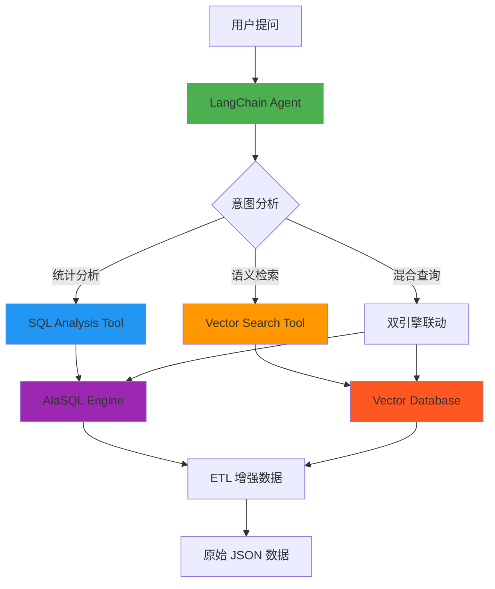
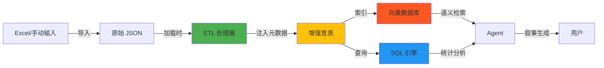
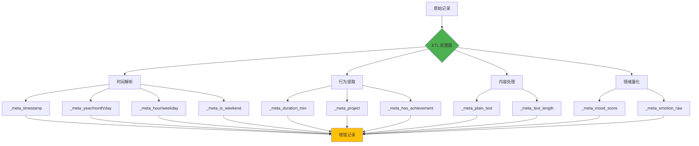
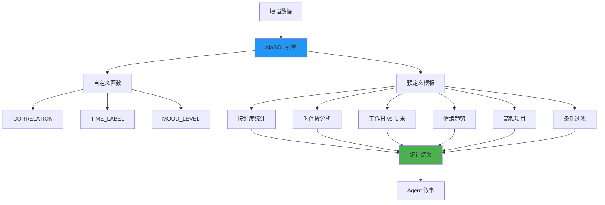
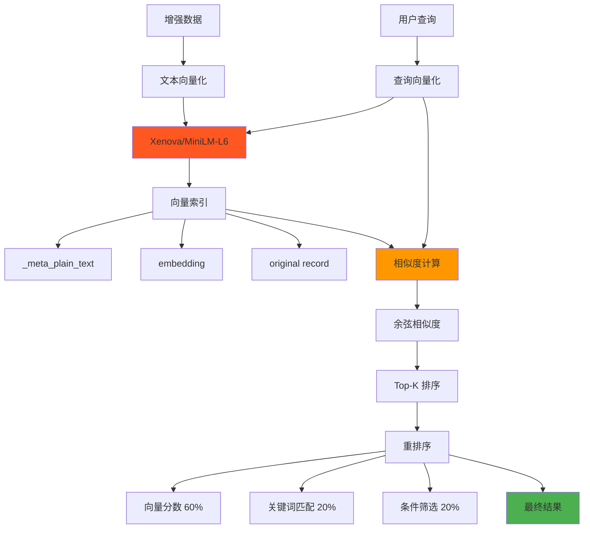
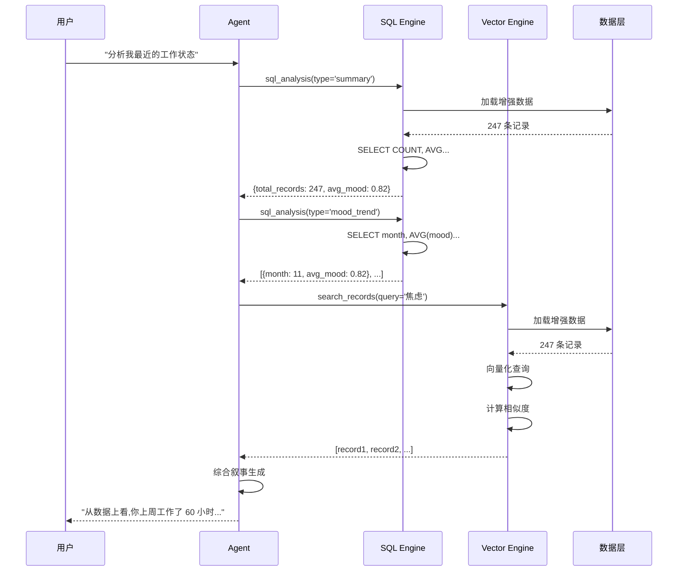
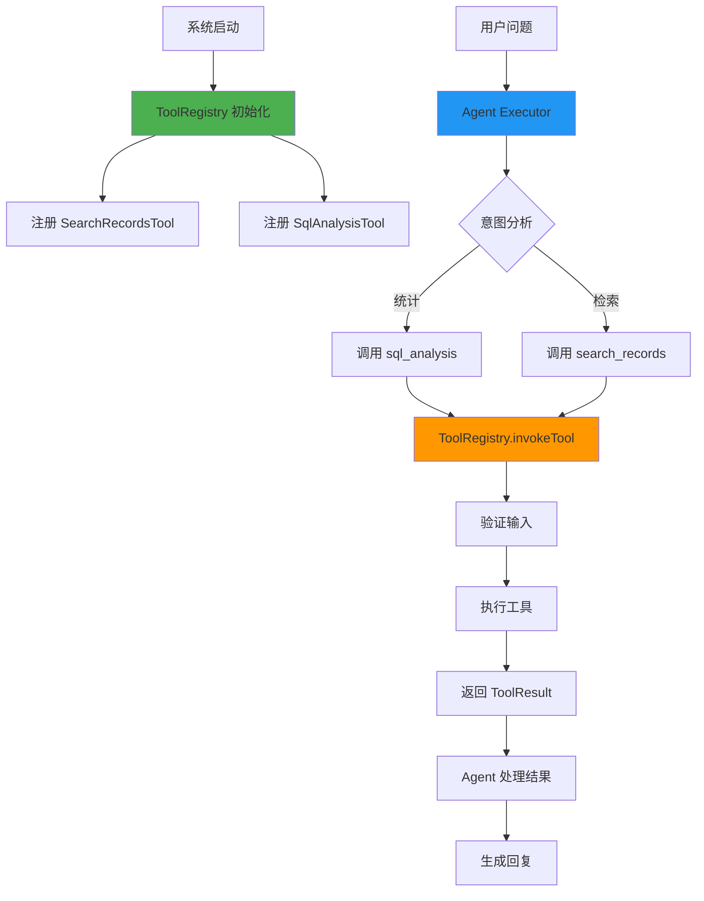
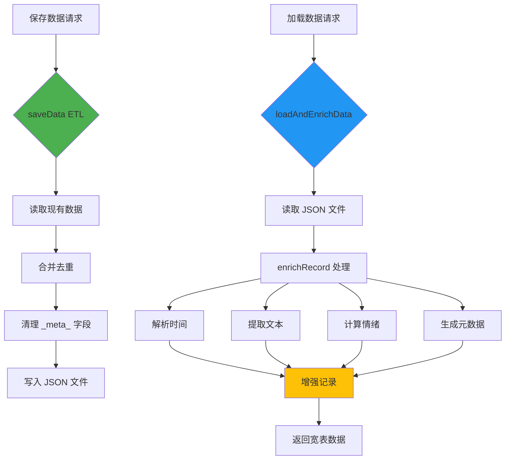

# 双模态数据库架构设计

## 系统总体架构



---

## 数据流转全景图



---

## ETL 数据增强流程



---

## SQL 分析引擎架构



---

## 向量检索引擎架构



---

## 双引擎协同工作流



---

## 工具注册与调用流程



---

## 数据存储与加载机制



---

## 关键设计原则

### 1. 单向依赖
```
展示层(Vue) → Agent 层(LangChain) → 工具层(Tools) → 数据层(ETL + SQL + Vector)
```

### 2. 关注点分离
- **数据层:** 只管加工和存储,不涉及业务逻辑
- **工具层:** 封装单一功能,符合 LangChain 规范
- **Agent 层:** 协调工具,生成叙事
- **展示层:** 纯 UI 交互

### 3. 零配置增强
- 用户无需手动触发 ETL
- 加载数据时自动增强
- 保存数据时自动清理

### 4. 向后兼容
- 原始 JSON 格式不变
- _meta_ 字段只在内存中存在
- 前端代码无需修改

---

## 性能优化策略

### 1. 懒加载向量模型
```javascript
// 首次使用时才加载
if (!embeddingModel) {
  embeddingModel = await loadEmbeddingModel()
}
```

### 2. 内存缓存
```javascript
// 向量库构建后缓存在内存
if (vectorDB.length === 0) {
  await buildVectorDatabase(data)
}
```

### 3. SQL 优化
```sql
-- 使用索引(虽然 AlaSQL 是内存库,但仍遵循最佳实践)
GROUP BY _meta_project
ORDER BY count DESC
LIMIT 10
```

### 4. 批量处理
```javascript
// ETL 批量处理,而非逐条
const enrichedData = rawData.map(enrichRecord)
```

---

## 扩展性设计

### 添加新的统计维度
1. 在 `enrichRecord` 中添加新的 `_meta_` 字段
2. 在 `SqlService` 中添加新的查询模板
3. (可选) 在 `SqlAnalysisTool` 中添加新的 `analysisType`

### 添加新的工具
1. 继承 `Tool` 基类
2. 实现 `invoke` 方法
3. 在 `ToolRegistry` 中注册

### 自定义 SQL 函数
```javascript
alasql.fn.YOUR_FUNCTION = (param) => {
  // 你的逻辑
  return result
}
```

---

## 技术栈总览

| 层级 | 技术 | 作用 |
|------|------|------|
| 前端 | Vue 3 + Naive UI | 用户界面 |
| Agent | LangChain 1.0 | 智能推理 |
| 工具 | Custom Tools | 功能封装 |
| SQL | AlaSQL | 统计分析 |
| 向量 | Xenova Transformers | 语义检索 |
| ETL | Custom JS | 数据加工 |
| 存储 | JSON File | 持久化 |

---

## 未来扩展方向

### 第二阶段:关联挖掘


### 第三阶段:主动提醒


### 第四阶段:预测模型


---

## 总结

**双模态数据库 = SQL 的精确 + 向量的灵活**

- ✅ 让数据"懂规矩"(ETL 标准化)
- ✅ 让数据"会计算"(SQL 引擎)
- ✅ 让数据"能理解"(向量检索)
- ✅ 让数据"会说话"(Agent 叙事)

**核心价值:从"电子流水账"进化为"个人数字生命体"**
