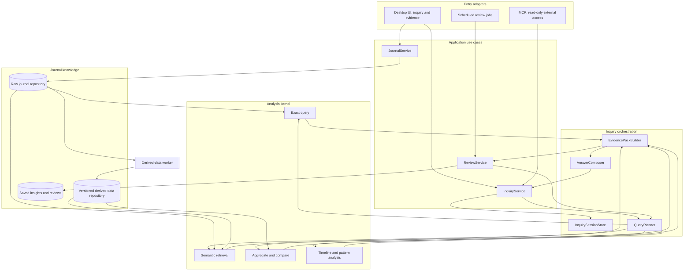

# Daily Log Target Architecture and Implementation Plan

> Status: Proposed implementation baseline  
> Audience: product owner, architect, developers, and reviewers  
> Date: 2026-08-17  
> Scope: evolve the existing Electron + Vue application into an evidence-grounded journal exploration system

## 1. Executive decision

Daily Log will be developed as:

> An evidence-grounded personal journal exploration system. It uses continuous inquiry as the primary interaction, treats journal entries as the source of truth, and helps the user recall, retrieve, compare, analyze, and reflect without presenting AI interpretations as facts.

The product is not a generic AI workbench, a dashboard collection, or a precomputed psychological profile. Data management, enrichment, analytics, visualization, summaries, conversational inquiry, and MCP are retained as capability layers around one shared exploration core.

This document is the implementation baseline. Where current code and this document disagree, new development should follow this document unless an explicit architecture decision supersedes it.

## 2. Decisions already accepted

The following decisions are considered approved for implementation planning:

1. Raw journal entries are the only authoritative personal-history data.
2. Facts, computations, and interpretations must be represented separately.
3. Important conclusions must reference journal evidence and analysis scope.
4. Continuous inquiry uses structured session state, not only full chat history and not only a rewritten standalone query.
5. UI, charts, scheduled reviews, and MCP must reuse the same application services.
6. AI-derived psychological fields are optional, versioned, rebuildable inferences.
7. Remote models may receive journal text when the user configures and invokes them. Remote desensitization is not a product requirement.
8. Model calls that use journal content must be visible and attributable to a provider, model, purpose, and source-record set.
9. Migration must be incremental. Existing working capabilities are wrapped and redirected before obsolete paths are removed.

## 3. Product outcomes and non-goals

### 3.1 Required outcomes

The system must let the user:

- ask natural-language questions about journal history;
- retrieve exact entries and fragment-level evidence;
- compare periods, projects, people, activities, and user-defined cohorts;
- continue with contextual follow-up questions such as "why", "compared with last year", and "only on workdays";
- distinguish source facts, deterministic calculations, and AI hypotheses;
- open the original entries behind a conclusion;
- save useful exploration results as reusable insights or reviews;
- receive scheduled weekly, monthly, or yearly reviews generated from the same analysis core;
- access the same read-only capabilities from MCP without a second query implementation.

### 3.2 Non-goals

- Building a general-purpose chat client or image-generation client.
- Treating cognitive patterns, Maslow needs, root causes, or mood labels as verified user facts.
- Exposing internal tools, prompts, or chain-of-thought as the primary user experience.
- Maintaining separate filtering, search, statistics, or enrichment logic for the desktop UI and MCP.
- Replacing the current storage engine before the unified contracts are proven.
- Claiming that all data remains local when a configured remote model is used.

## 4. Product model

The primary user loop is:

```text
question
  -> evidence retrieval
  -> deterministic filtering / comparison / computation
  -> explicit interpretation
  -> source inspection
  -> contextual follow-up
  -> saved insight or next question
```

Capability layers are not required to become top-level navigation items. Product navigation represents user workflows; internal layers represent engineering responsibilities.

## 5. Target architecture



### 5.1 Dependency rule

Dependencies point inward:

```text
adapters -> application -> domain contracts
                         -> analysis ports
infrastructure --------> domain/application ports
```

The domain and application layers must not import Electron, Vue, IPC, MCP, filesystem paths, AlaSQL, model SDKs, or provider-specific response formats.

### 5.2 Single-core rule

Only application services may coordinate user use cases. UI, IPC handlers, scheduled jobs, and MCP translate input and output; they must not reproduce query or analysis logic.

## 6. Epistemic model

All user-facing analysis must use these categories:

| Category | Meaning | Example | Required provenance |
|---|---|---|---|
| `evidence` | Text or fields directly present in a journal record | "I felt exhausted after the meeting" | record ID, field, excerpt, timestamp |
| `computation` | Deterministic result over a defined record set | 12 entries, average duration 43 minutes | operation, scope, record IDs or cohort fingerprint |
| `hypothesis` | Model-generated interpretation | Work meetings may be associated with lower energy | supporting evidence, model, confidence, limitations |
| `suggestion` | Optional reflective prompt or next action | Compare meeting days with non-meeting days | basis and explicit non-factual label |

Derived metadata must also declare one of these derivation classes:

- `deterministic`: reproducible without an LLM;
- `extracted`: an LLM extracts an explicit item from text;
- `inferred`: an LLM interprets meaning not explicitly stated.

`inferred` fields must never silently become filters for factual claims. When used for retrieval or comparison, the response must disclose that inferred metadata affected the result set.

## 7. Normative data contracts

The following TypeScript-style definitions are normative contracts. The implementation may use TypeScript, JSDoc, JSON Schema, or runtime validators, but field meanings must remain stable.

### 7.1 Journal record

```ts
interface JournalRecord {
  id: string
  occurredAt: string
  contentHtml: string
  contentText: string
  project?: string
  durationMinutes?: number
  experience?: string
  moodColor?: string
  achievement?: boolean
  source: 'local' | 'import'
  revision: number
}
```

The initial repository adapter may map the existing field names (`_id`, `time`, `ganshou`, and others) into this contract without rewriting stored data.

### 7.2 Derived annotation

```ts
interface DerivedAnnotation<T = unknown> {
  recordId: string
  field: string
  value: T
  derivation: 'deterministic' | 'extracted' | 'inferred'
  generator: {
    kind: 'rule' | 'model'
    name: string
    version: string
  }
  evidenceRefs: string[]
  confidence?: number
  createdAt: string
  sourceRevision: number
}
```

An annotation is stale when `sourceRevision` no longer matches the journal record revision or when its generator version changes.

### 7.3 Inquiry scope and plan

```ts
interface InquiryScope {
  dateRange?: { start?: string; end?: string }
  projects?: string[]
  people?: string[]
  weekdays?: string[]
  recordIds?: string[]
  includeInferredMetadata?: boolean
}

interface InquiryPlan {
  normalizedQuestion: string
  operations: Array<{
    id: string
    type: 'exact_query' | 'semantic_search' | 'aggregate' | 'compare' | 'timeline'
    input: Record<string, unknown>
    dependsOn: string[]
  }>
  scope: InquiryScope
  expectedOutput: 'records' | 'metric' | 'comparison' | 'timeline' | 'mixed'
}
```

The planner may use an LLM, but the resulting plan is validated before execution. Only allow-listed operations may run.

### 7.4 Evidence pack

```ts
interface EvidenceRef {
  id: string
  recordId: string
  occurredAt: string
  field: string
  excerpt: string
  relevance?: number
}

interface ComputedMetric {
  id: string
  label: string
  value: number | string | null
  unit?: string
  operation: string
  sampleSize: number
  recordIds?: string[]
  cohortFingerprint?: string
}

interface EvidencePack {
  id: string
  schemaVersion: string
  question: string
  scope: InquiryScope
  evidence: EvidenceRef[]
  metrics: ComputedMetric[]
  comparisons: Array<Record<string, unknown>>
  limitations: Array<{
    code: string
    message: string
    severity: 'info' | 'warning'
  }>
  generatedAt: string
}
```

`EvidencePack` contains evidence and deterministic analysis only. Model interpretations belong in the exploration result, not inside the evidence pack.

### 7.5 Exploration result

```ts
interface ExplorationResult {
  sessionId: string
  evidencePackId: string
  answer: string
  facts: Array<{ text: string; evidenceRefs: string[] }>
  computations: Array<{ text: string; metricRefs: string[] }>
  hypotheses: Array<{
    text: string
    evidenceRefs: string[]
    confidence: 'low' | 'medium' | 'high'
    model: string
  }>
  suggestions: Array<{ text: string; basisRefs: string[] }>
  followUps: string[]
}
```

### 7.6 Inquiry session

```ts
interface InquirySession {
  id: string
  goal?: string
  currentQuestion: string
  scope: InquiryScope
  entities: Record<string, string[]>
  comparison?: Record<string, unknown>
  evidencePackIds: string[]
  acceptedConclusions: string[]
  unresolvedQuestions: string[]
  updatedAt: string
}
```

A follow-up updates this state. The executor receives the relevant state plus the current question; it is not limited to a standalone rewrite and does not require the full raw chat history.

### 7.7 Model call receipt

```ts
interface ModelCallReceipt {
  id: string
  provider: string
  model: string
  purpose: 'planning' | 'enrichment' | 'composition' | 'review'
  recordIds: string[]
  contentScope: 'metadata' | 'excerpts' | 'full_records'
  requestedAt: string
  success: boolean
}
```

The receipt records what was shared, not the API key. Persisting the full outbound prompt is optional and should be configurable.

## 8. Application service contracts

### 8.1 Journal repository port

```ts
interface JournalRepository {
  get(id: string): Promise<JournalRecord | null>
  list(scope: InquiryScope): Promise<JournalRecord[]>
  upsert(records: JournalRecord[]): Promise<{ added: number; updated: number }>
  update(id: string, patch: Partial<JournalRecord>): Promise<JournalRecord>
  getRevision(id: string): Promise<number | null>
}
```

### 8.2 Analysis service

```ts
interface AnalysisService {
  execute(plan: InquiryPlan): Promise<EvidencePack>
  exactQuery(scope: InquiryScope): Promise<EvidenceRef[]>
  semanticSearch(query: string, scope: InquiryScope, limit: number): Promise<EvidenceRef[]>
  aggregate(spec: Record<string, unknown>, scope: InquiryScope): Promise<ComputedMetric[]>
  compare(spec: Record<string, unknown>, scope: InquiryScope): Promise<Record<string, unknown>[]>
}
```

### 8.3 Inquiry service

```ts
interface InquiryService {
  start(input: { question: string; scope?: InquiryScope }): Promise<ExplorationResult>
  followUp(input: { sessionId: string; question: string }): Promise<ExplorationResult>
  getSession(sessionId: string): Promise<InquirySession | null>
  getEvidencePack(id: string): Promise<EvidencePack | null>
}
```

### 8.4 Review service

```ts
interface ReviewService {
  generate(input: {
    recipe: 'weekly' | 'monthly' | 'yearly' | string
    scope: InquiryScope
  }): Promise<{
    artifactId: string
    result: ExplorationResult
  }>
}
```

Review recipes call the same planner and analysis service as interactive inquiry. They must not maintain separate filtering and statistics logic.

## 9. Required workflows

### 9.1 New inquiry

1. UI submits a question and optional explicit scope to `InquiryService.start`.
2. The service creates an `InquirySession`.
3. `QueryPlanner` produces and validates an `InquiryPlan`.
4. `AnalysisService` executes deterministic and retrieval operations.
5. `EvidencePackBuilder` normalizes evidence, metrics, provenance, and limitations.
6. `AnswerComposer` receives only the question, relevant inquiry state, and evidence pack.
7. The response is stored with links to its evidence pack and returned to the UI.

### 9.2 Follow-up inquiry

1. UI calls `InquiryService.followUp(sessionId, question)`.
2. The service resolves references from structured session state.
3. The planner decides whether to reuse, narrow, extend, or replace the prior scope.
4. Existing evidence may be reused only when its source revisions and plan inputs remain valid.
5. A new evidence pack is created for every materially different analysis.

### 9.3 Import or edit

1. `JournalService` validates and writes raw records through `JournalRepository`.
2. Updated records receive a new revision.
3. Derived annotations and vector chunks for affected record IDs are invalidated.
4. Deterministic metadata may be regenerated immediately.
5. LLM enrichment remains optional and may run later.

### 9.4 Scheduled review

1. A scheduler selects a named review recipe and date scope.
2. `ReviewService` executes the recipe through the shared analysis core.
3. The generated artifact retains its evidence pack and model-call receipts.
4. Opening a review allows the user to inspect evidence or start a follow-up inquiry.

### 9.5 MCP request

1. MCP validates protocol input.
2. MCP maps the request to `InquiryService`, `JournalService`, or an evidence lookup.
3. The application service returns the same contracts used by the desktop app.
4. MCP serializes the result; it does not read `appData.json` directly.

## 10. UI information architecture

### 10.1 Primary navigation

Recommended product navigation:

1. **Explore**: default screen; continuous inquiry plus evidence inspection.
2. **Journal**: browse, filter, import, edit, and inspect records.
3. **Reviews**: saved insights and scheduled weekly/monthly/yearly reviews.
4. **Settings**: model providers, enrichment, automation, theme, and data locations.

`ToolTester`, raw tool JSON, internal prompts, and detailed execution logs are available only in development mode.

### 10.2 Explore screen

The default desktop layout contains:

- a conversation area;
- an evidence panel linked to claims in the current answer;
- visible scope such as dates, projects, and comparison cohorts;
- compact method and limitation disclosures;
- suggested follow-up questions.

The UI should show operations such as "searched 38 records" or "compared two periods". It must not expose private chain-of-thought or present model reasoning text as an auditable computation.

### 10.3 Analysis visualizations

Charts render typed metrics and comparisons from an `EvidencePack`. Chart components must not invoke low-level tools independently. Clicking a chart mark should reveal the contributing record set or start a scoped inquiry.

### 10.4 Reviews

Chronicle becomes the Reviews experience. A review is a saved exploration artifact with:

- period and recipe;
- concise narrative;
- evidence-backed metrics;
- hypotheses clearly labeled;
- links to supporting entries;
- an action to continue exploring in the same context.

## 11. Target logical module layout

Physical file moves are optional until behavior is covered by tests. The target logical boundaries are:

```text
src/main/
  domain/
    journal/
    evidence/
    inquiry/
  application/
    JournalService.js
    AnalysisService.js
    InquiryService.js
    ReviewService.js
  infrastructure/
    persistence/JsonJournalRepository.js
    persistence/JsonDerivedDataRepository.js
    analysis/AlaSqlAnalysisAdapter.js
    retrieval/LocalVectorSearchAdapter.js
    llm/OpenAICompatibleGateway.js
  adapters/
    ipc/
    jobs/

mcp-server/
  adapter/
  index.js

src/renderer/src/
  features/
    explore/
    journal/
    reviews/
    settings/
    devtools/
```

The application layer owns transaction boundaries and orchestration. Infrastructure modules implement ports. Adapters contain no domain decisions.

## 12. Mapping from current implementation

| Current implementation | Target responsibility | Migration action |
|---|---|---|
| `src/main/data/dataLoader.js` | JSON journal repository | Wrap first; preserve storage format; stop direct calls from UI/tool code |
| `src/utils/diary-plugin/formatter.js` | deterministic annotation generator | Retain pure functions; emit versioned deterministic annotations |
| `src/main/data/SqlService.js` | aggregate/compare adapter | Place behind `AnalysisService` |
| `src/main/tools/queryRecords.js` | exact query operation | Convert to an internal analysis operation |
| `src/main/tools/searchRecords.js` | semantic retrieval adapter | Return `EvidenceRef`; move cache into writable user-data storage |
| `src/main/tools/sqlAnalysis.js` | aggregate operation | Convert output to typed metrics |
| `src/main/tools/insight.js` | comparison recipes | Split deterministic calculations from narrative interpretation |
| `src/main/etl/llmEnricher.js` | optional derived-data worker | Add annotation provenance, source revision, and generator version |
| `src/main/intent/analyzer.js` | query planner candidate | Produce validated `InquiryPlan`, not only tool-name recommendations |
| `src/main/agent/executor.js` | inquiry orchestration candidate | Move orchestration into `InquiryService`; retain provider/tool execution behind ports |
| `src/main/agent/ipcHandlers.js` | IPC adapter | Split by use case; delegate immediately to application services |
| `src/main/etl/summaryService.js` | review recipe and composer | Reuse `ReviewService` and evidence packs; remove duplicate analysis paths |
| `AnalysisPage.vue` and chart components | evidence-pack renderers | Remove direct tool execution from chart components |
| `AgentWorkbench.vue` | Explore experience | Make primary screen and add linked evidence/scope state |
| `ReActPanel.vue` | operation/evidence panel | Remove chain-of-thought display; show operations, evidence, and limitations |
| `DataBoardTab.vue` | Journal management experience | Keep as secondary workflow and split orchestration from view code |
| `ChroniclePage.vue` | Reviews experience | Render saved review artifacts |
| `ToolTester.vue` | development tooling | Hide from production navigation |
| `.mimocode/tools/daily-log.ts` | obsolete duplicate adapter | Replace with calls to application services, then remove duplicate data logic |
| `mcp-server/index.js` | MCP protocol adapter | Package and test as a real entry point after shared services exist |

## 13. Migration strategy

Use a branch-by-abstraction strategy. Do not begin with a directory-wide rewrite.

### Phase 0: Contracts and characterization

Deliverables:

- runtime schemas for the normative contracts;
- a test script and a non-ignored test location;
- representative sanitized fixtures covering dates, projects, people, HTML content, missing fields, and AI metadata;
- characterization tests for current loading, exact query, semantic search, aggregation, edit, and summary behavior;
- baseline MCP health test showing the current failure and the expected target response.

Definition of done:

- current observable behavior is captured before refactoring;
- tests run from one documented command;
- no product behavior intentionally changes.

### Phase 1: Unified journal and analysis core

Deliverables:

- `JournalRepository` adapter over the existing JSON data;
- `AnalysisService` facade over current query/search/SQL capabilities;
- `EvidenceRef`, `ComputedMetric`, and `EvidencePack` builders;
- revision-based invalidation for edited records;
- current IPC paths redirected to the facade behind a feature flag.

Definition of done:

- all new analysis code reads through `JournalRepository`;
- UI behavior remains compatible;
- exact query and aggregation results match characterization tests;
- no MCP or summary code directly reads the journal JSON in new code.

### Phase 2: Inquiry engine and continuous follow-up

Deliverables:

- `InquirySessionStore`;
- validated `InquiryPlan` generation;
- `InquiryService.start` and `InquiryService.followUp`;
- `AnswerComposer` enforcing facts/computations/hypotheses separation;
- model call receipts;
- compatibility adapter for the existing `assistant:chat` IPC channel.

Definition of done:

- a follow-up can reuse and modify structured scope;
- every factual answer claim has evidence references;
- failed planning falls back to safe exact/semantic retrieval or asks for clarification;
- no answer is produced from an unvalidated operation plan.

### Phase 3: Explore-first product experience

Deliverables:

- Explore as the default screen;
- linked evidence panel and scope display;
- journal management as a secondary screen;
- charts rendered from evidence-pack metrics;
- ToolTester and internal execution details restricted to development mode.

Definition of done:

- the main workflow can be completed without opening data-management or tool-testing screens;
- clicking an answer citation opens the correct source record;
- clicking a chart segment reveals its record cohort;
- the UI labels hypotheses and limitations distinctly from facts.

### Phase 4: Shared reviews and working MCP

Deliverables:

- `ReviewService` recipes using the shared analysis core;
- migration of existing summaries into review artifacts where feasible;
- MCP adapter calling application services;
- packaged MCP launch command and configuration documentation;
- contract tests proving desktop and MCP queries use equivalent evidence.

Definition of done:

- scheduled and interactive analysis of the same scope produce compatible metrics;
- MCP `health` succeeds in a clean install;
- MCP does not import `.mimocode` runtime code or duplicate journal enrichment;
- MCP remains read-only unless a separate write-capability decision is approved.

### Phase 5: Cleanup and hardening

Deliverables:

- removal of superseded query, rerank, and adapter implementations;
- narrow IPC allow-list and production-safe Electron settings;
- caches stored under writable user-data paths;
- documentation updated to match real privacy and provider behavior;
- obsolete general AI-client features removed from the primary path.

Definition of done:

- one implementation exists for each query/analysis capability;
- production UI contains no developer-only navigation;
- no architectural document claims unimplemented capabilities;
- all migration feature flags have an owner and removal date.

## 14. Acceptance scenarios

These scenarios are required end-to-end acceptance tests.

### Scenario A: Evidence-backed recall

Question: "When did I mention being exhausted after meetings?"

Expected:

- matching excerpts and dates;
- links to original entries;
- disclosed search scope;
- no causal explanation unless requested.

### Scenario B: Continuous comparison

1. Ask: "How was my energy during Project A last year?"
2. Follow up: "Compare it with the same period this year."
3. Follow up: "Only include workdays."

Expected:

- the session preserves Project A and the comparison intent;
- each follow-up produces a new evidence pack with the updated scope;
- sample sizes and missing AI-energy coverage are visible.

### Scenario C: Reflection with uncertainty

Question: "Why did my mood get worse in March?"

Expected:

- deterministic trend evidence first;
- possible contributing factors labeled as hypotheses;
- supporting and contradicting records when available;
- limitations when the sample or metadata coverage is weak.

### Scenario D: Data revision

1. Run an inquiry that cites a record.
2. Edit the cited record.
3. Repeat the inquiry.

Expected:

- stale derived annotations and vector chunks are invalidated;
- new results reflect the updated record revision;
- previously saved artifacts retain their original provenance and show that the source changed.

### Scenario E: Cross-entry consistency

Run the same bounded question through the desktop app and MCP.

Expected:

- equivalent scope, evidence record IDs, and deterministic metrics;
- presentation may differ;
- no independent MCP calculation path.

## 15. Testing requirements

### 15.1 Contract tests

- Validate all external and internal boundary payloads.
- Version persisted contracts such as evidence packs and review artifacts.
- Reject invalid planner operations and unknown filter fields.

### 15.2 Repository tests

- Preserve existing data without destructive migration.
- Verify import deduplication, record revision, atomic writes, and recovery from malformed cache files.
- Verify raw records never acquire persisted derived fields unintentionally.

### 15.3 Analysis tests

- Test date boundaries and time zones.
- Test empty cohorts, missing fields, partial AI coverage, and deterministic aggregation.
- Test semantic results with a stable fake embedding provider where exact vectors are not relevant.

### 15.4 Inquiry tests

- Test pronoun and scope resolution from structured session state.
- Test follow-up narrowing, comparison, replacement, and reset.
- Test citation integrity: every referenced evidence ID must exist in the evidence pack.
- Test that hypotheses cannot be serialized into the facts collection.

### 15.5 Adapter tests

- IPC and MCP adapters share application-service fixtures.
- Renderer tests cover citation navigation and fact/hypothesis presentation.
- MCP tests cover initialize, list tools, health, inquiry, evidence lookup, and protocol errors.

## 16. Operational and privacy requirements

- API keys remain outside persisted analysis artifacts and logs.
- A model call receipt is available to the user for calls involving journal content.
- Provider failures degrade to deterministic search/analysis when possible.
- LLM enrichment failure never makes raw journal data unavailable.
- Cache corruption triggers rebuild or isolation, not raw-data overwrite.
- Model and prompt versions are stored with derived annotations and saved review artifacts.
- Logging must avoid printing full journal text by default.
- No claim of local-only processing is shown while a remote provider is configured for the active operation.

## 17. Developer work-package order

Create implementation issues in this dependency order:

1. Add test runner, fixtures, and characterization coverage.
2. Add contracts and runtime validation.
3. Introduce `JournalRepository` over current JSON storage.
4. Introduce `AnalysisService` and evidence-pack builders.
5. Redirect one exact-query IPC path through the new core as a vertical slice.
6. Redirect semantic search, SQL aggregation, and comparison operations.
7. Add record revision and derived-data invalidation.
8. Add structured inquiry sessions and validated plans.
9. Add evidence-grounded answer composition and model call receipts.
10. Build the Explore-first UI and linked evidence panel.
11. Convert charts and reviews to evidence-pack consumers.
12. Replace MCP data access with application-service calls.
13. Remove duplicate paths only after parity tests pass.
14. Harden Electron/IPC boundaries and update documentation.

Each issue must state:

- affected contract and use case;
- migration or compatibility requirement;
- tests required before merge;
- feature flag or rollback behavior when relevant;
- old path that becomes removable after completion.

## 18. Pull-request rules during migration

- A pull request should complete one vertical behavior or one reusable contract, not move directories without behavior coverage.
- New UI code must not invoke low-level tools directly.
- New MCP code must not access journal files directly.
- New LLM output must be validated before entering the application layer.
- Changes to evidence, session, or artifact schemas require a versioning and migration note.
- Removal of old code requires a repository-wide caller check and passing parity tests.

## 19. Architecture review checkpoints

Conduct a review at the end of each phase:

| Checkpoint | Review question |
|---|---|
| Phase 0 | Do tests capture enough current behavior to refactor safely? |
| Phase 1 | Is there one authoritative read/analysis path and a usable evidence contract? |
| Phase 2 | Do follow-ups preserve inquiry intent without relying on full raw history? |
| Phase 3 | Does the product now feel like journal exploration rather than a developer workbench? |
| Phase 4 | Do reviews and MCP genuinely reuse the same core? |
| Phase 5 | Have duplicate implementations and misleading claims been removed? |

## 20. Handoff definition

This design is ready to hand to developers when:

- the product owner accepts this document as the target baseline;
- Phase 0 through Phase 2 are treated as the first engineering milestone;
- a technical owner is assigned to the normative contracts;
- developers agree not to begin with a full rewrite;
- implementation issues are derived from Section 17 and linked back to this document.

The first milestone is successful when a user can ask a question, inspect cited evidence, ask a contextual comparison follow-up, and receive a response that separates facts, computations, and hypotheses, all through the new shared core while existing data remains intact.
