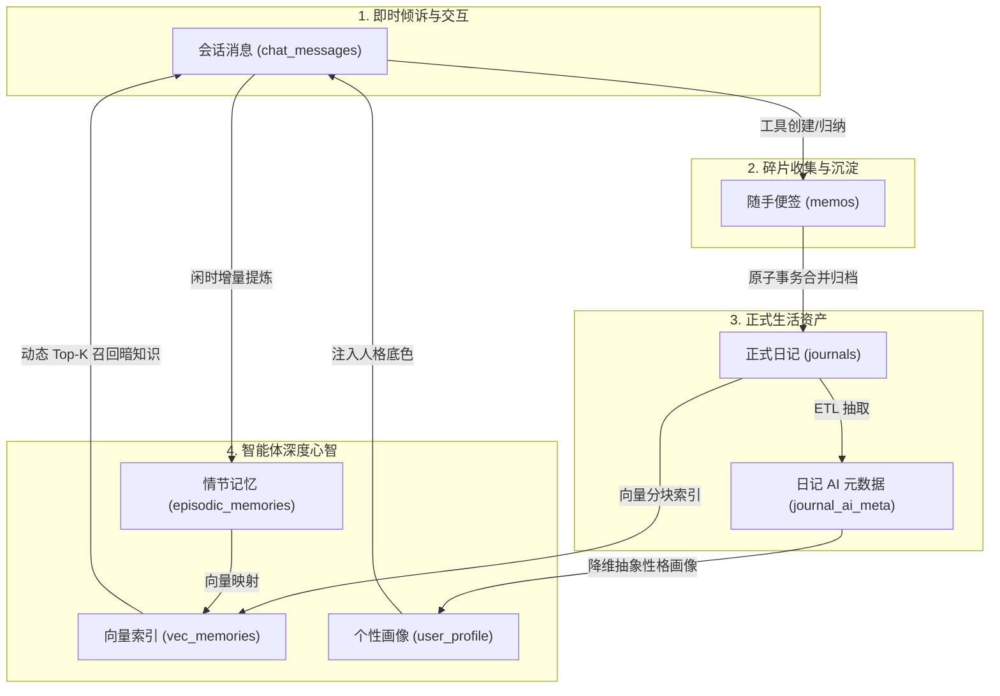
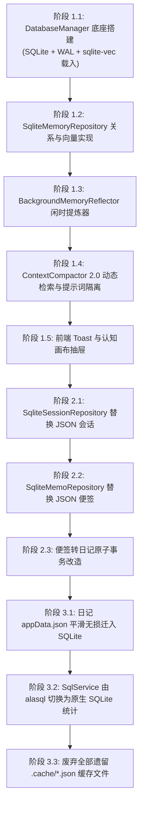

# 《小鸡日记智能体自进化与统一数据底座规格说明书 (SPEC)》

> **版本**：v1.0.0  
> **状态**：Draft / Approved for Development  
> **适用技术栈**：Electron 38+ (Node 22+)、Vue 3.5、SQLite (WAL 模式) + `sqlite-vec`、Transformers.js (BGE-small-zh)

---

## 1. 核心设计原则与业务边界

1. **零破坏性更新（Add-Only & Temporal Invalidation）**：任何认知或事实演进不得直接覆盖或抹除历史，所有事实演进通过新增版本、有效时间戳（Validity Window）或置信失效标记（`is_valid = 0`）维护。
2. **轻量与端侧闭环（Zero Cloud Dependency for Core Logic）**：向量计算、关系存储与状态管理完全运行在本地 Electron 主进程与 Worker 线程中，杜绝用户隐私上传与外网延迟。
3. **读写分离与零锁死（WAL Concurrency）**：全局使用 SQLite WAL 模式，确保前台渲染进程（Vue 3）的高频读与后台 Worker 密集反思写互不阻塞。
4. **渐进式统一（Non-Breaking Progressive Migration）**：解耦开发顺序，先跑通自进化记忆闭环，再收拢会话与便签，最后统一日记与分析，每一步均具备向后兼容与一键回滚能力。

---

## 2. 全局业务耦合拓扑与数据飞轮

应用内各业务实体并非孤立存在，而是构成一条**“倾诉 ➔ 草稿 ➔ 资产 ➔ 认知 ➔ 陪伴”**的数据飞轮闭环：



### 关键耦合点与防裂缝规则：
- **耦合点 A（便签 ➔ 日记）**：便签合并或转为日记时，必须在一个数据库事务中完成（`INSERT journals` + `UPDATE memos SET status='archived'`），禁止拆解为两个异步操作。
- **耦合点 B（会话 ➔ 记忆）**：会话提炼出的记忆必须携带外键 `source_session_id` 与 `source_message_id`，支持用户在前端溯源查看事实出处。
- **耦合点 C（日记 ➔ 记忆与隐私）**：日记包含极度敏感隐私，日记向量与会话向量在同一张虚拟表中时，必须依靠 `source_type` 严格隔离。在闲聊聊天检索中，**物理禁止召回 `source_type = 'diary'` 的具体细节**。
- **耦合点 D（纠偏 ➔ 召回权重）**：用户在会话反驳或在 UI 认知画布上点击删除记忆时，系统执行逻辑下线（`is_valid = 0`），检索必须带上 `WHERE is_valid = 1`。

---

## 3. 统一存储引擎与表结构设计 (Schema V1)

统一数据库文件位于用户数据目录：`app.getPath('userData')/daily_log.db`。

### 3.1 核心配置与 PRAGMA 规范
```sql
PRAGMA journal_mode = WAL;
PRAGMA synchronous = NORMAL;
PRAGMA foreign_keys = ON;
PRAGMA temp_store = MEMORY;
PRAGMA busy_timeout = 5000;
```

### 3.2 实体表定义

#### 1) 确定性画像与偏好表 (`user_profile`)
```sql
CREATE TABLE IF NOT EXISTS user_profile (
    key TEXT PRIMARY KEY,               -- 如 'communication_style', 'user_mbti', 'timezone'
    value TEXT NOT NULL,                -- 结构化文本或 JSON 字符串
    category TEXT DEFAULT 'general',    -- 'preference' | 'persona' | 'system'
    updated_at INTEGER NOT NULL         -- 毫秒时间戳
);
```

#### 2) 情节记忆事实表 (`episodic_memories`)
```sql
CREATE TABLE IF NOT EXISTS episodic_memories (
    id TEXT PRIMARY KEY,                -- 'mem_' + nanoid
    content TEXT NOT NULL,              -- 凝练的事实陈述（例如：“用户养了一只英短蓝猫叫老王”）
    source_type TEXT NOT NULL,         -- 'chat' | 'diary' | 'user_manual'
    source_id TEXT,                     -- 关联的 session_id、journal_id 或 NULL
    category TEXT DEFAULT 'fact',       -- 'fact' | 'emotion' | 'habit' | 'relation'
    confidence REAL DEFAULT 1.0,        -- 置信度 (0.0 ~ 1.0)
    is_valid INTEGER DEFAULT 1,        -- 1: 有效, 0: 已失效(被纠偏或用户删除)
    invalidated_reason TEXT,            -- 失效原因（如 'conflict_with_mem_xxx', 'user_deleted'）
    created_at INTEGER NOT NULL,        -- 产生时间戳
    updated_at INTEGER NOT NULL
);

CREATE INDEX IF NOT EXISTS idx_memories_valid_source 
ON episodic_memories(is_valid, source_type);
```

#### 3) sqlite-vec 向量虚表 (`vec_memories`)
```sql
-- 使用 sqlite-vec 扩展，384 维 (适配 bge-small-zh-v1.5)
CREATE VIRTUAL TABLE IF NOT EXISTS vec_memories USING vec0(
    memory_id TEXT PRIMARY KEY,
    embedding float[384]
);
```

#### 4) 会话与消息表 (`chat_sessions` & `chat_messages`)
```sql
CREATE TABLE IF NOT EXISTS chat_sessions (
    id TEXT PRIMARY KEY,                -- 'sess_' + timestamp
    title TEXT NOT NULL,
    pinned INTEGER DEFAULT 0,
    context_summary TEXT,               -- 滑动窗口外的滚动前情提要
    created_at INTEGER NOT NULL,
    updated_at INTEGER NOT NULL
);

CREATE TABLE IF NOT EXISTS chat_messages (
    id TEXT PRIMARY KEY,                -- 'msg_' + nanoid
    session_id TEXT NOT NULL REFERENCES chat_sessions(id) ON DELETE CASCADE,
    role TEXT NOT NULL,                 -- 'user' | 'assistant' | 'system'
    content TEXT NOT NULL,
    react_steps TEXT,                   -- JSON 字符串 (Thought/Action/Observation)
    created_at INTEGER NOT NULL
);

CREATE INDEX IF NOT EXISTS idx_messages_session 
ON chat_messages(session_id, created_at ASC);
```

#### 5) 便签表 (`memos`)
```sql
CREATE TABLE IF NOT EXISTS memos (
    id TEXT PRIMARY KEY,                -- 'memo_' + timestamp
    content TEXT NOT NULL,
    topic TEXT DEFAULT '日常',
    status TEXT DEFAULT 'draft',        -- 'draft' | 'archived' | 'converted'
    converted_journal_id TEXT,          -- 若已转日记，记录其 ID
    created_at INTEGER NOT NULL,
    updated_at INTEGER NOT NULL
);
```

#### 6) 日记与 AI 分析表 (`journals` & `journal_ai_meta`)
```sql
CREATE TABLE IF NOT EXISTS journals (
    id TEXT PRIMARY KEY,
    content TEXT NOT NULL,
    project TEXT DEFAULT '日常',
    occurred_at TEXT NOT NULL,          -- ISO 时间或 YYYY-MM-DD HH:mm:ss
    duration_min INTEGER DEFAULT 0,
    is_deleted INTEGER DEFAULT 0,
    created_at INTEGER NOT NULL,
    updated_at INTEGER NOT NULL
);

CREATE TABLE IF NOT EXISTS journal_ai_meta (
    journal_id TEXT PRIMARY KEY REFERENCES journals(id) ON DELETE CASCADE,
    summary TEXT,
    mood_tags TEXT,                     -- JSON Array: ["开心", "充实"]
    energy_level INTEGER,               -- 1 ~ 10
    people_involved TEXT,               -- JSON Array
    items TEXT,                         -- JSON Array
    key_quotes TEXT,                    -- JSON Array
    updated_at INTEGER NOT NULL
);
```

---

## 4. 核心功能模块规格设计

### 4.1 DatabaseManager (单例核心驱动)
- **路径**：`src/main/infrastructure/db/DatabaseManager.js`
- **职能**：
  - 管理 SQLite 连接池生命周期；
  - 动态载入 `sqlite-vec` 二进制动态库；
  - 提供 `transaction(fn)` 事务包裹器；
  - 执行版本迁移（Migration）；
  - 拦截 Electron `before-quit`，执行 WAL Checkpoint 与连接断开。

### 4.2 SqliteMemoryRepository (记忆与向量数据访问层)
- **路径**：`src/main/infrastructure/persistence/SqliteMemoryRepository.js`
- **核心接口**：
  - `addMemory({ content, sourceType, sourceId, category, embedding })`: 事务写入关系表与向量表。
  - `searchSimilarMemories(queryEmbedding, { limit = 3, sourceType = 'chat' })`: 执行 `sqlite-vec` 向量内积检索，并 JOIN `episodic_memories` 过滤 `is_valid = 1`。
  - `invalidateMemory(memoryId, reason)`: 逻辑失效（`is_valid = 0`），并将 `vec_memories` 对应行移除或置零。
  - `getProfileKV()` / `updateProfileKV(key, value)`: 读写用户偏好。

### 4.3 BackgroundMemoryReflector (后台自进化增量提炼器)
- **路径**：`src/main/agent/memory/BackgroundMemoryReflector.js`
- **触发机制**：
  1. **静默闲时触发**：每轮对话结束后重置一个 3 分钟的防抖计时器（Debounce Timer）。若 3 分钟无新输入，提取最近对话对；
  2. **轮次累积触发**：未提炼对白达到 6 轮强制唤醒；
  3. **退出保护触发**：Electron 捕获 `before-quit`，截留 800ms 处理队列中未结的记忆反思。
- **提炼规范（严格 JSON Schema 输出）**：
  ```json
  {
    "type": "object",
    "properties": {
      "decisions": {
        "type": "array",
        "items": {
          "type": "object",
          "properties": {
            "action": { "type": "string", "enum": ["ADD", "UPDATE_CONFLICT", "NOOP"] },
            "content": { "type": "string" },
            "conflict_memory_id": { "type": "string" },
            "category": { "type": "string", "enum": ["fact", "habit", "preference"] }
          },
          "required": ["action", "content"]
        }
      }
    }
  }
  ```
- **广播通知**：完成有价值事实入库后，发送 IPC 消息 `agent:memory-evolved` 给渲染进程，带上提炼摘要。

### 4.4 ContextCompactor 2.0 (按需动态激活与双层隔离)
- **路径**：`src/main/agent/middleware/contextCompactor.js`
- **组装流**：
  1. 读取 `user_profile` 生成**【第一层：行为与人格底色】**（永久常驻）；
  2. 针对用户最新 `userQuery`，调用本地 BGE 计算向量，通过 `SqliteMemoryRepository` 获取 Top-3 关联事实，生成**【第二层：后台暗知识（隐性注入）】**；
  3. 附带滑动窗口内最近 6 条活跃对白；
  4. 严控 Prompt 指令：*“暗知识仅作语境理解，严禁主动说‘我记得你...’炫耀记忆力”*。

### 4.5 UI 交互层：认知画布与瞬时 Toast
- **路径**：`src/renderer/src/components/CognitiveCanvasDrawer.vue`
- **功能**：
  - **Toast 提示**：监听 `agent:memory-evolved`，右上方 3 秒平滑淡入淡出（如：`🌱 小鸡记住了：您最近在准备秋招`）；
  - **认知抽屉**：抽屉面板展示全部 `is_valid = 1` 的记忆卡片，支持按时间排序与关键词搜索；
  - **纠偏操作**：点击卡片 [×] 按钮调用 IPC `core-memory:delete`，卡片飞出并在数据库中置为失效；点击卡片文本支持就地编辑。

---

## 5. 模块开发顺序与依赖推进计划

遵循**“底座先行 ➔ 记忆独立闭环 ➔ 会话便签归并 ➔ 日记终极统一”**的原则，严格防范业务断裂。



| 推进顺序 | 模块 / 任务名 | 前置依赖 | 交付产物与验证标准 |
| :--- | :--- | :--- | :--- |
| **P1.1** | `DatabaseManager` | 无 | 建立 `daily_log.db`，成功加载 `sqlite-vec` 扩展，WAL 模式开启正常。 |
| **P1.2** | `SqliteMemoryRepository` | P1.1 | 单元测试通过：偏好 KV 读写、情节记忆插入、向量 Top-K 召回与逻辑失效。 |
| **P1.3** | `BackgroundMemoryReflector` | P1.2 | 对话闲置 3 分钟后，后台 Worker 自动提炼事实并写入 SQLite，支持 `before-quit` 刷新。 |
| **P1.4** | `ContextCompactor 2.0` | P1.2 | 对话前置微秒级检索 Top-3 事实并隐性注入 System Prompt，阻断日记事件泄露。 |
| **P1.5** | UI 认知画布与 Toast | P1.3, P1.4 | 提炼成功后前端弹出轻量 Toast；抽屉中可查看记忆卡片并一键删除/纠偏。 |
| **P2.1** | 会话持久化迁移 | P1.1 | `agent-sessions.json` 自动导入 `chat_sessions` 表，单条消息追加写入，性能大幅提升。 |
| **P2.2** | 便签持久化迁移 | P1.1 | `memos.json` 自动导入 `memos` 表，便签增删改查完全走 SQLite。 |
| **P2.3** | 便签转日记事务 | P2.2 | 改造 `convertToRecord` 与 `mergeToRecord` 为单一原子事务。 |
| **P3.1** | 日记平滑迁入 | P1.1 | 启动时无感将 `appData.json` 导入 `journals` 表，保留原始备份。 |
| **P3.2** | SQL 分析引擎重构 | P3.1 | [SqlService.js](file:///D:/Pcode/play/_apps/daily_log_vue/src/main/data/SqlService.js) 切换为原生 SQLite 查询，删除 `alasql` 依赖。 |

---

## 6. 完整测试案例矩阵 (Test Matrix)

### 6.1 单元测试 (Unit Tests)

| 编号 | 测试模块 | 测试场景与输入 | 预期输出与断言 |
| :--- | :--- | :--- | :--- |
| **UT-01** | `DatabaseManager` | 并发执行 50 次异步写操作与 50 次读操作 | 无 `SQLITE_BUSY` 报错，所有事务完整提交，WAL 正常工作。 |
| **UT-02** | `SqliteMemoryRepository` | 插入 5 条不同领域记忆，输入测试向量进行搜索 | 返回按余弦距离升序的前 3 条，且 `is_valid = 0` 的记录绝不出现在结果中。 |
| **UT-03** | `MemoryReflector` | 输入对白：“我喜欢喝冰美式，千万别给我加热的” | 提炼决策输出 `ADD`，内容包含“偏好喝冰美式”，符合 JSON Schema。 |
| **UT-04** | `MemoryReflector` | 现有记忆“老王是同学”，输入对白：“你记错了，老王是我养的猫” | 决策输出 `UPDATE_CONFLICT`，旧记忆置为 `is_valid = 0`，新记忆入库。 |
| **UT-05** | `ContextCompactor` | 包含日记向量与会话向量同时命中相似度阈值 | 生成的 Prompt 中仅包含 `source_type = 'chat'` 事实，日记具体事件被严格过滤。 |

### 6.2 集成与业务耦合测试 (Integration Tests)

| 编号 | 耦合链路 | 动作序列 | 验证重点 |
| :--- | :--- | :--- | :--- |
| **IT-01** | 会话 ➔ 闲时提炼 ➔ 前端感知 | 1. 发送消息交代新事实；<br/>2. 等待 3 分钟闲置或触发 IPC 模拟；<br/>3. 检查数据库与前端事件。 | 数据库中新增一条 `episodic_memories` 记录；前端收到 `agent:memory-evolved` 事件并触发 Toast。 |
| **IT-02** | 跨会话回忆体验 | 1. 会话 A 建立记忆“用户准备去杭州旅游”；<br/>2. 关闭会话 A，新建会话 B；<br/>3. 会话 B 发送“明天就要出发了，好期待”。 | 会话 B 的 LLM 能够结合杭州旅游提供行程建议，且回复中不出现机械的“我查了记忆”句式。 |
| **IT-03** | 认知画布手动纠偏 | 1. 在 UI 认知抽屉中点击删除“老王是猫”卡片；<br/>2. 再次提问关于老王的话题。 | 数据库中该条记忆 `is_valid` 变为 0；随后的对话检索不再召回该记忆。 |
| **IT-04** | 便签转日记原子事务 | 1. 选中 3 条便签执行“合并归档为日记”；<br/>2. 模拟中途断电/进程中断。 | 数据状态要么全成功（便签变为 `archived` 且日记生成），要么全回滚，绝无半成品残留。 |
| **IT-05** | 进程退出保护 | 1. 触发一次耗时提炼任务；<br/>2. 立即触发 Electron `app.emit('before-quit')`。 | 退出被优雅延迟数百毫秒，任务状态或队列持久化成功后进程安全终结。 |

---

## 7. 风险评估与应急回滚预案

1. **`sqlite-vec` 跨平台二进制兼容风险**：
   - *风险*：Windows、Mac、Linux 下打包可能遇到原生模块架构不匹配。
   - *预案*：在 `DatabaseManager` 中设置优雅降级层：若 `sqlite-vec` 载入失败，自动降级为使用现有 [LocalVectorSearchAdapter.js](file:///D:/Pcode/play/_apps/daily_log_vue/src/main/infrastructure/retrieval/LocalVectorSearchAdapter.js) 的内存余弦检索，保证软件核心功能永不崩溃。
2. **存量 JSON 数据迁移损毁风险**：
   - *风险*：从旧版 `appData.json` / `agent-sessions.json` 导入 SQLite 时格式解析异常。
   - *预案*：迁移执行前，自动将源 JSON 文件复制为 `.bak.json` 备份；迁移完成后计算记录条数 Checksum，比对无误后才切换读取源。
3. **模型反思提炼死循环或 Token 暴增**：
   - *风险*：频繁对话导致后台高频调用大模型造成费用增加。
   - *预案*：设置滑动窗口令牌桶（Token Bucket）：单日/单小时反思提炼上限设为 20 次，超限后仅进行本地规则匹配或延后至深夜闲时处理。
